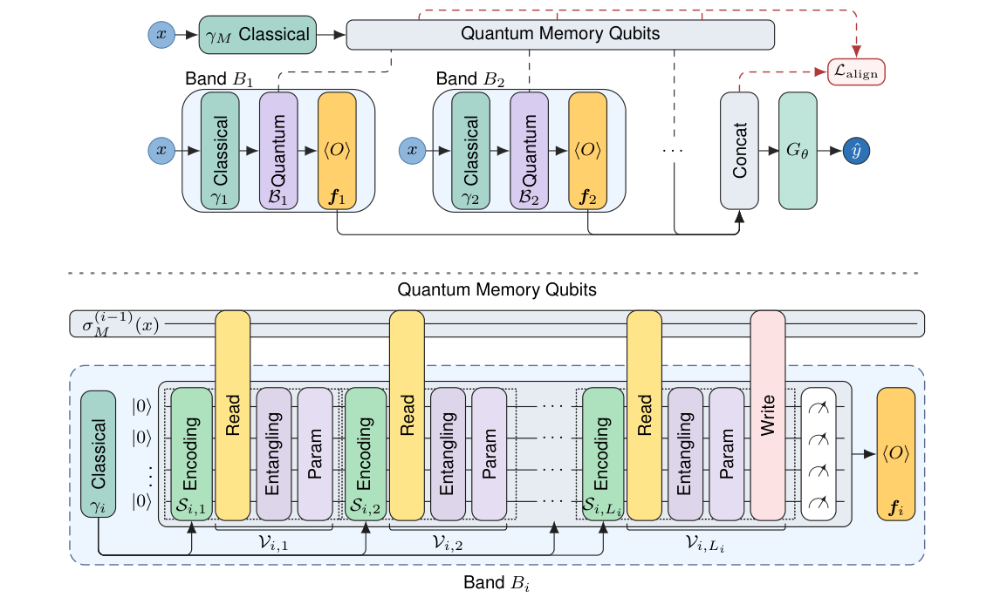
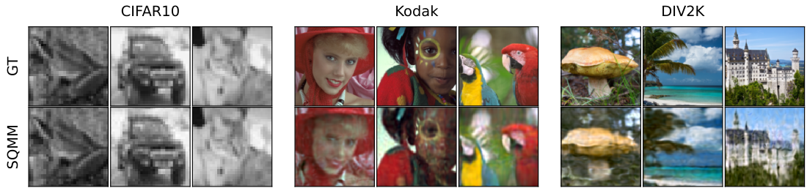
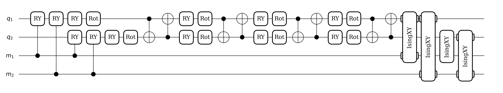

# Spectral Quantum Memory for Implicit Neural Representations

**Daniel A. Moroz-Broitman, Eliya Nachmani** · Ben Gurion University · NeurIPS 2026

[Paper](https://neurips.cc/virtual/2026/loc/paris/poster/152323) · [arXiv](https://arxiv.org/abs/2611.04574) · [Project page](https://kiiwii10.github.io/SQMM_page/)

SQMM is a quantum implicit neural representation (QINR) whose data reuploading bands share a small coherent **quantum memory register**. Each band reads the memory, computes on its own coordinate upload, and writes part of its state back, so later bands build on what earlier bands computed.



## Main points

- **Memory coupled bands.** Prior multiband QINRs combine their bands only in the classical decoder. In SQMM the bands also exchange information through 2 shared memory qubits that are never measured.
- **Spectral theory.** With input independent read and write layers, the memory state is an operator valued Fourier series whose support is contained in the Minkowski sum of the band spectra. Memory reweights and reuses frequencies but creates no new primitive ones.
- **Spectral memory alignment loss.** A training only loss, $\mathcal L_{\mathrm{align}}$, matches the Fourier occupancy of the memory (full Pauli probes) to the spectrum of the features emitted by the bands so far.
- **Compact.** About 650 parameters, matching the QIREN budget, for every dataset.

## Results

MSE (×10⁻³, mean ± SD, lower is better) as reported in the paper. $\text{SQMM}_{2048}$ estimates every expectation from 2048 measurement shots.

**Base benchmark** (QIREN protocol, Table 1)

| | SQMM | SQMM₂₀₄₈ | QIREN | QVF | IGA | FINER | SIREN | MSA-INR |
|---|---|---|---|---|---|---|---|---|
| Cello | **0.48 ± 0.08** | 0.76 ± 0.06 | 6.79 ± 0.35 | – | 4.87 ± 0.01 | 3.73 ± 0.44 | 5.02 ± 0.08 | 7.04 ± 1.23 |
| Astronaut | **1.12 ± 0.10** | 2.86 ± 0.53 | 5.90 ± 0.49 | 12.61 ± 1.65 | 2.01 ± 0.53 | 2.80 ± 0.31 | 2.15 ± 0.22 | 2.03 ± 0.28 |
| Camera | **0.38 ± 0.08** | 1.27 ± 0.16 | 2.19 ± 0.31 | 4.43 ± 1.38 | 1.07 ± 0.46 | 1.96 ± 0.62 | 0.76 ± 0.47 | 1.14 ± 0.14 |
| Coffee | **0.78 ± 0.05** | 1.79 ± 0.16 | 2.52 ± 0.67 | 14.38 ± 6.80 | 1.63 ± 0.42 | 1.85 ± 0.31 | 2.26 ± 0.40 | 1.37 ± 0.19 |

**Audio** (100 clips per corpus)

| | SQMM | QIREN | FINER | SIREN | CAFE (enc.) |
|---|---|---|---|---|---|
| GTZAN | **4.71 ± 0.17** | 44.19 ± 1.88 | 5.14 ± 1.06 | 8.65 ± 0.61 | 6.42 ± 1.34 |
| UrbanSound8K | **6.11 ± 0.27** | 51.83 ± 0.86 | 8.56 ± 2.35 | 15.55 ± 1.49 | 10.83 ± 3.75 |
| VCTK | **1.00 ± 0.03** | 10.70 ± 0.10 | 1.66 ± 0.21 | 2.98 ± 0.15 | 2.25 ± 0.34 |

**Images.** On 100 grayscale CIFAR10 images SQMM reaches MSE **0.46 ± 0.02**, against 0.90 for the closest baseline (MSA-INR) and 1.67 for QIREN. On Kodak and DIV2K, from 32² up to full resolution, SQMM has the lowest MSE of all evaluated models at every size.



## Quick start

```bash
pip install torch torchvision pennylane numpy scikit-image pillow soundfile
python main.py --dataset cello --runs 5
```

- `--dataset`: `cello`, `camera`, `coffee`, `astronaut`
- `--epochs`, `--growth`, `--align-weight`, `--divergence`, `--config my_config.json` override the defaults

Training uses the MSE with $\mathcal L_{\mathrm{align}}$. Each run writes `out/<dataset>/runs.csv` and `results.json` with the best epoch MSE and PSNR.

| File | Contents |
|---|---|
| `model.py` | SQMM: bands, memory read and write couplings, density matrix simulation |
| `losses.py` | MSE and $\mathcal L_{\mathrm{align}}$ |
| `train.py` | band growth schedule, training loop, per dataset defaults |
| `datasets.py` | Cello and the scikit-image targets on a $[-1,1]^d$ grid |

One band of the trained Cello model, with reads before the uploads and writes at the end:



## Citation
```bibtex
@misc{morozbroitman2026spectralquantummemoryimplicit,
      title={Spectral Quantum Memory for Implicit Neural Representations}, 
      author={Daniel A. Moroz-Broitman and Eliya Nachmani},
      year={2026},
      eprint={2611.04574},
      archivePrefix={arXiv},
      primaryClass={quant-ph},
      url={https://arxiv.org/abs/2611.04574}, 
}
```
